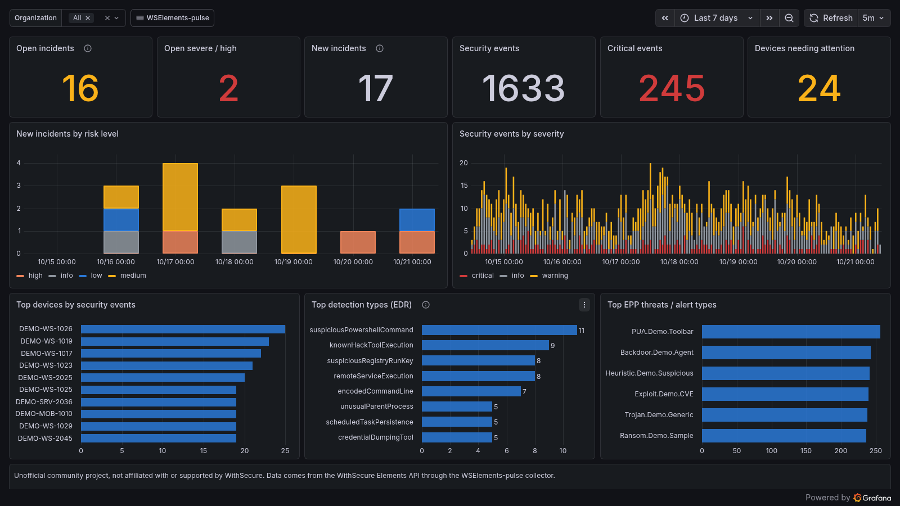
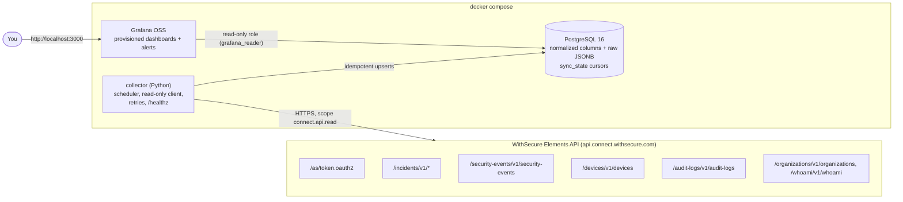

# WSElements-pulse

Community-maintained collector and Grafana dashboards for **WithSecure Elements** data.
A small Python service polls the Elements REST API on a schedule, stores the data in
PostgreSQL, and Grafana reads PostgreSQL to give you dashboards, filters and alerts. Everything
runs with one `docker compose up`.

> [!WARNING]
> **UNOFFICIAL PROJECT.** WSElements-pulse is an independent, community-maintained open-source
> project. It is **not affiliated with, endorsed by, or supported by WithSecure**. "WithSecure"
> and "WithSecure Elements" are used only to describe which API this tool reads. Do not contact
> WithSecure support about this tool; open an issue in this repository instead.

**Read-only by design.** The collector only ever requests the `connect.api.read` scope, and its
HTTP client refuses (before anything reaches the network) any request that is not on a short
allowlist of read endpoints. It never changes anything in Elements.

## Features

- Incremental, idempotent sync of **incidents (Broad Context Detections)** and their
  **detections**, **security events** (EPP and EDR, optionally Collaboration Protection and
  Exposure Management), **devices** and **audit logs**.
- Multi-organization / MSP support: poll a list of organizations, or discover every company
  under a partner organization. Every table has an `organization_id` column, and every dashboard
  has an organization filter.
- Six provisioned Grafana dashboards (Overview, Incidents, Security events, Devices, Audit logs,
  Collector health) and two example alert rules.
- Respects the API: token caching, exponential backoff with jitter on 429/5xx, `Retry-After`
  support, configurable delay between requests.
- A demo mode with **fictional** data (`seed`), so you can explore the dashboards without an API key.



*Screenshot generated from the `seed` command: every organization, device and user is fictional.*

## Architecture



## Quick start

Requirements: Docker with the Compose plugin.

### Demo (no API key)

```bash
git clone <this repository> && cd WSElements-pulse
cp .env.example .env            # set the three passwords
docker compose up -d db grafana
docker compose run --rm collector seed --days 30
```

Open <http://localhost:3000> and sign in with `GRAFANA_ADMIN_USER` / `GRAFANA_ADMIN_PASSWORD`.
To start from a clean database later: `docker compose run --rm collector seed --reset`.

### With your Elements tenant

1. Create an API client in Elements Security Center, **read-only**
   (see [docs/api-client.md](docs/api-client.md)).
2. Put the client ID and secret in `.env` (`ELEMENTS_CLIENT_ID`, `ELEMENTS_CLIENT_SECRET`).
3. Check the credentials and endpoint access:

   ```bash
   docker compose run --rm collector check
   ```

4. Start everything:

   ```bash
   docker compose up -d
   docker compose logs -f collector
   ```

The first run fetches the initial history (30 days of incidents, 7 days of security events and
audit logs by default). To fetch more history once:

```bash
docker compose run --rm collector backfill --days 90 --collector security_events
```

If you tried the demo first, remove the fictional data before collecting real data:
`docker compose down -v` (deletes the volumes), then `docker compose up -d`.

## Required API permission

| Scope | Used for |
|---|---|
| `connect.api.read` | Everything. This is the only scope ever requested. |

Use an API client created as **read-only**. The tool never requests `connect.api.write`, but it
cannot detect whether the API client *could* be granted write access, so a read-only client is
your guarantee.

Endpoints called (all read operations):

| Endpoint | Collector | Notes |
|---|---|---|
| `POST /as/token.oauth2` | all | client credentials, `scope=connect.api.read` |
| `GET /whoami/v1/whoami` | startup, `check` | default organization of the client |
| `GET /organizations/v1/organizations` | startup / discovery | organization names, MSP discovery |
| `GET /incidents/v1/incidents` | `incidents` | incremental on `updatedTimestamp`, 50 per page |
| `GET /incidents/v1/detections` | `detections` | per new/changed incident, 100 per page |
| `POST /security-events/v1/security-events` | `security_events:<group>` | read query; incremental on `persistenceTimestamp`, 200 per page, ≤30-day windows |
| `GET /devices/v1/devices` | `devices` | full snapshot every run (active, blocked, inactive) |
| `GET /audit-logs/v1/audit-logs` | `audit_logs` | incremental on `serverTimestamp`, ≤30-day windows |

## CLI

```text
elements-pulse run        # run all enabled collectors until SIGTERM (default container command)
elements-pulse check      # validate credentials, read scope and access to each endpoint
elements-pulse backfill --days N [--collector NAME] [--org UUID]   # one-off history fetch
elements-pulse health     # collector status from the database (exit 1 if stale)
elements-pulse migrate    # apply database migrations (also done automatically by `run`)
elements-pulse seed [--days 30] [--organizations 3] [--reset]      # fictional demo data
```

With Docker: `docker compose run --rm collector <command>`.

## Configuration

Configuration comes from environment variables, optionally from a YAML file
(`PULSE_CONFIG_FILE`, see [config/config.example.yaml](config/config.example.yaml)), then defaults.
Environment variables win. Nested keys use `PULSE_` plus `__` between levels, for example
`PULSE_COLLECTORS__DEVICES__INTERVAL_MINUTES=30`.

**Secrets are only read from environment variables or Docker secrets** (`*_FILE` variables).
The YAML file is rejected if it contains `client_id`, `client_secret` or `database_url`.

| Setting | Env variable | Default |
|---|---|---|
| API client ID / secret | `ELEMENTS_CLIENT_ID`, `ELEMENTS_CLIENT_SECRET` (or `*_FILE`) | none |
| Database URL | `DATABASE_URL` (or `DATABASE_URL_FILE`) | set by compose |
| Organizations to poll | `PULSE_ORGANIZATIONS__IDS` (comma-separated UUIDs) | client's default org |
| Discover child companies | `PULSE_ORGANIZATIONS__DISCOVER` | `false` |
| API base URL | `PULSE_API__BASE_URL` | `https://api.connect.withsecure.com` |
| Delay between requests | `PULSE_API__REQUEST_DELAY_SECONDS` | `0.25` |
| Max retries (429/5xx/network) | `PULSE_API__MAX_RETRIES` | `5` |
| Incidents: interval / backfill | `PULSE_COLLECTORS__INCIDENTS__INTERVAL_MINUTES` / `__BACKFILL_DAYS` | `5` / `30` |
| Detections: interval / cap per run | `PULSE_COLLECTORS__DETECTIONS__INTERVAL_MINUTES` / `__MAX_INCIDENTS_PER_RUN` | `5` / `50` |
| Security events: interval / backfill | `PULSE_COLLECTORS__SECURITY_EVENTS__INTERVAL_MINUTES` / `__BACKFILL_DAYS` | `5` / `7` |
| Security events: engine groups | `PULSE_COLLECTORS__SECURITY_EVENTS__ENGINE_GROUPS` | `epp,edr` |
| Devices: interval | `PULSE_COLLECTORS__DEVICES__INTERVAL_MINUTES` | `15` |
| Audit logs: interval / backfill | `PULSE_COLLECTORS__AUDIT_LOGS__INTERVAL_MINUTES` / `__BACKFILL_DAYS` | `15` / `7` |
| Disable a collector | `PULSE_COLLECTORS__<NAME>__ENABLED=false` | all enabled |
| Overlap re-read before cursor | `PULSE_COLLECTORS__<NAME>__OVERLAP_MINUTES` | `10` |
| Grafana listen address | `GRAFANA_BIND_ADDRESS` (`0.0.0.0` for LAN access) | `127.0.0.1` |
| Log level / format | `PULSE_LOG_LEVEL`, `PULSE_LOG_FORMAT` (`json`/`console`) | `INFO`, `json` |
| Metrics retention | `PULSE_RETENTION__API_REQUESTS_DAYS` / `__COLLECTOR_RUNS_DAYS` | `14` / `30` |

The full reference, including Docker secrets and the MSP setup, is in
[docs/configuration.md](docs/configuration.md).

## How sync works

- Each collector keeps one cursor per organization in `sync_state` (for security events, one per
  engine group). It reads from `cursor - overlap`, in ascending order, and moves the cursor
  forward after each stored page. A crash or restart resumes where it stopped.
- Every write is `INSERT ... ON CONFLICT DO UPDATE` on the API's own identifiers, so overlaps,
  reruns and backfills never create duplicates. The cursor never moves backwards.
- Each record keeps the full API payload in a `raw` JSONB column next to the normalized
  columns the dashboards use, so new panels can use fields that aren't normalized yet.
- Devices have no "changed since" filter, so the collector reads a full snapshot. Devices
  missing from a *complete* snapshot get `removed_at` set and drop out of the dashboards.

Tables: `organizations`, `sync_state`, `collector_runs`, `api_requests`, `incidents`,
`incident_detections`, `security_events`, `devices`, `device_status_daily`, `audit_logs`, plus the
views `v_devices_current`, `v_device_agent_status` and `v_collector_health`
([schema](src/elements_pulse/migrations)).

## Dashboards and alerts

| Dashboard | Content |
|---|---|
| Overview | open incidents, new incidents over time, events by severity, top devices, top detection types, top threats |
| Incidents (BCDs) | filters by risk level and status, daily/weekly trend, categories, resolutions, MITRE ATT&CK techniques, incident table |
| Security events | EPP vs EDR, by engine, severity, classification (alert type), action, device and threat; latest events |
| Devices | protection status and its daily trend, OS and agent versions, outdated agents, end-of-life OS, devices not seen for 7 days |
| Audit logs | actions over time, top actions and users, entries table |
| Collector health | stale/failing collectors, last sync, items per run, API latency, 429/5xx |

Variables: organization (all dashboards), time range, risk level / severity, engine group, engine.

Alert rules (in `grafana/provisioning/alerting/rules.yaml`):

- **New critical incident**: an incident with risk level `severe` or severity `critical` was
  collected in the last 15 minutes.
- **Collector stale**: a collector hasn't succeeded for 3 intervals.

Grafana provisions the rules but **no contact point**. Add one under *Alerting → Contact points*
(email, Teams, Slack, webhook...) and route it in the notification policies.

The dashboard JSON is generated by `scripts/build_dashboards.py`. Edit the script, then run
`python scripts/build_dashboards.py`. CI checks that the committed JSON matches the script.

## Known limitations

- **Unofficial.** API behaviour can change without notice. Tested against the public API
  specification, not with any guarantee from WithSecure.
- The API caps security event and audit log queries at 31 days per request. The collector
  splits longer ranges into 30-day windows. How far back data exists depends on Elements
  retention.
- Rate limits aren't documented. Defaults are conservative. If you see `429` on the Collector
  health dashboard, raise `PULSE_API__REQUEST_DELAY_SECONDS` or the intervals.
- Detections cost one API call (or more) per new or changed incident. They are capped per run
  (`max_incidents_per_run`), so a large initial backfill drains over several runs.
- Devices are a full snapshot each run, which costs about `device count / 200 × 3` calls per run.
- "Median time to close" uses the last update time of closed incidents, so it is approximate.
- "Outdated agent" means older than the newest version seen *in your own data* for the same org,
  device type and OS. It doesn't compare with the latest WithSecure release.
- `security_events.persistence_ts` is used for sync, so late-arriving events are picked up.
  Dashboards also bucket by that time, which can differ slightly from the client-side time.
- Only the endpoints listed above are collected. Response actions, exposure findings, profiles,
  software updates and invitations are not collected (yet). Contributions are welcome.

## Data protection

The database stores operational security data: device names, usernames and email addresses,
IP-related details inside raw payloads, and detection command lines. Treat it as sensitive. Keep
PostgreSQL unexposed (the default), use strong passwords, restrict who can sign in to Grafana,
and see [SECURITY.md](SECURITY.md).

## Contributing

See [CONTRIBUTING.md](CONTRIBUTING.md). Never put real credentials, tenant names, device names or
customer data in issues, code, tests, fixtures or screenshots.

## License

[MIT](LICENSE). WithSecure and WithSecure Elements are trademarks of their respective owner. They
are used here only to identify the API this tool reads, with no claim of affiliation.
